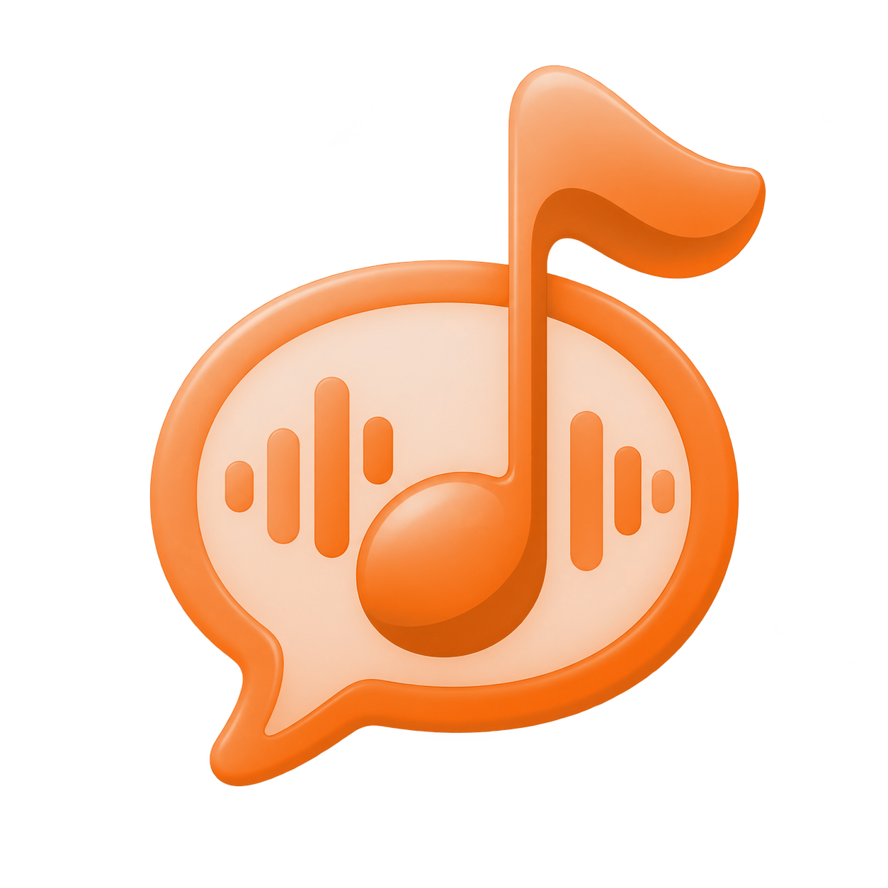
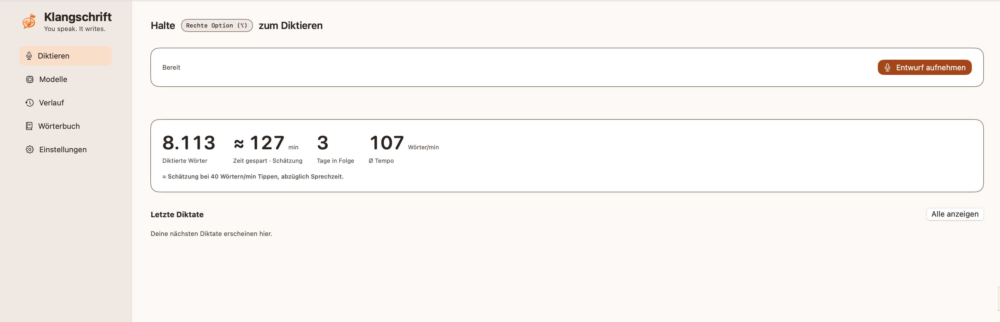
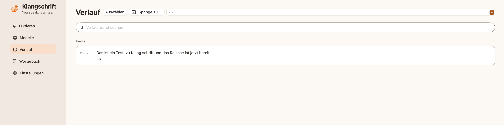
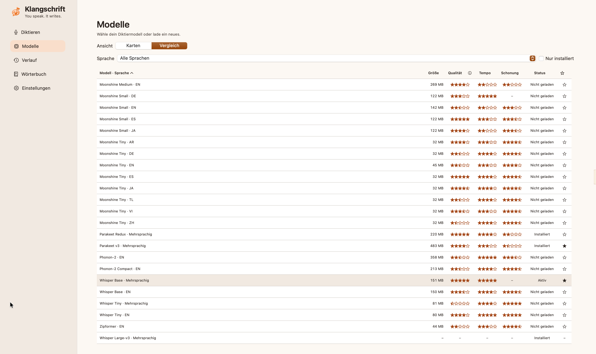
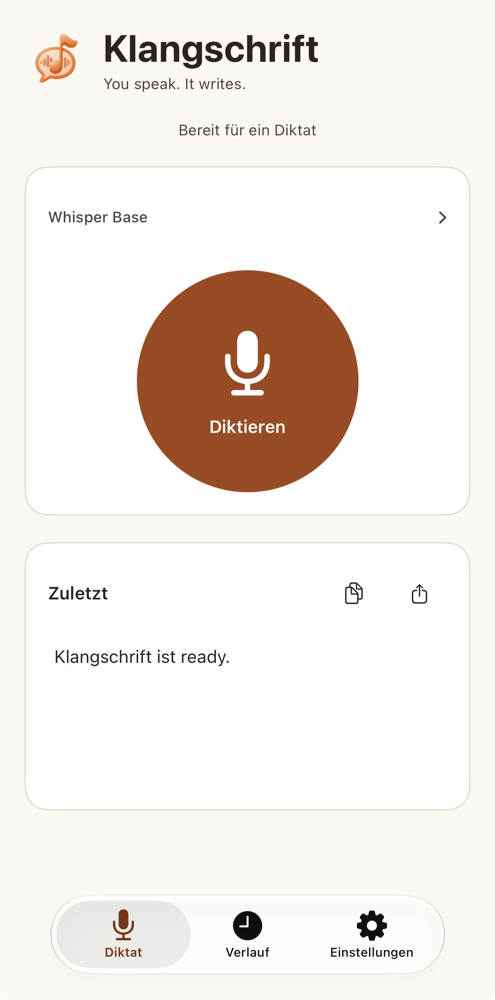
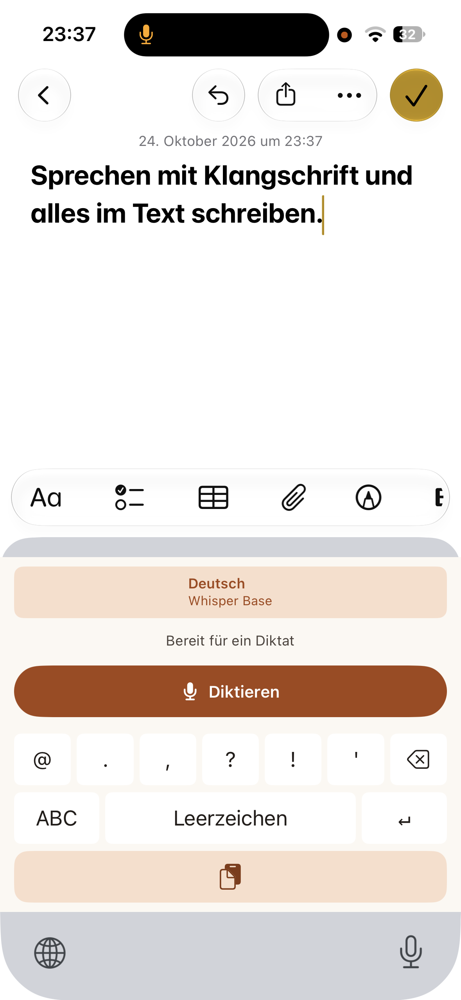
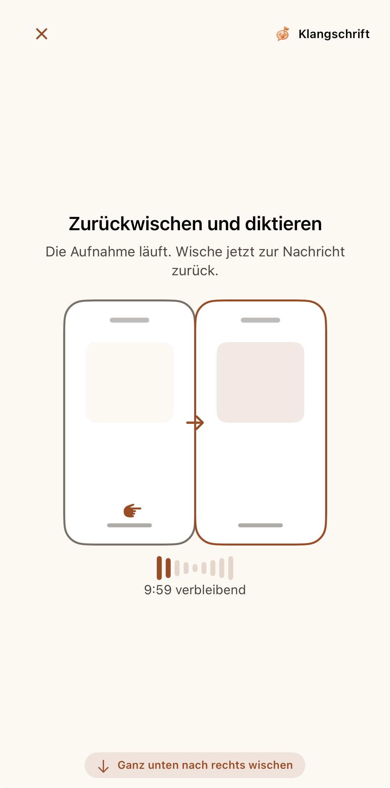
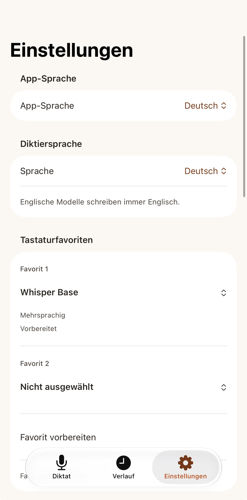

# Klangschrift

[English](README.md)

Diktieren auf dem Mac und dem iPhone. Die Spracherkennung läuft auf dem Gerät, deine Aufnahmen gehen nirgendwo hin.

## Was es kann

- **Mac:** Taste halten, sprechen, loslassen – der Text landet im aktiven Fenster. Eine kleine Pille am Bildschirmrand zeigt, dass Klangschrift zuhört. Dazu ein Verlauf mit Suche und Kalender.
- **iPhone:** eine eigene Tastatur zum Diktieren in jeder App, dazu Verlauf und Speicherverwaltung.
- **Wörterbuch:** eigene Wörter und Ersetzungen, damit Namen und Fachbegriffe richtig geschrieben werden.

Mehr Bilder

  
  
  
  

## Installieren

**Mac** (Apple Silicon, macOS 26 oder neuer):

1. Die ZIP-Datei unter [Releases](https://github.com/miggidev618/klangschrift/releases) herunterladen, entpacken und `Klangschrift.app` in den Programme-Ordner ziehen.
2. **Erster Start:** Klangschrift hat keine Apple-Signatur, deshalb blockiert macOS die App zuerst. Unter Systemeinstellungen → Datenschutz & Sicherheit nach unten scrollen und bei Klangschrift auf **„Dennoch öffnen“** klicken. Danach die App nochmals öffnen und bestätigen.
3. **Zugriffe erlauben:** Die Einrichtung fragt nach Mikrofon, Bedienungshilfen und Eingabeüberwachung. **Nach der Eingabeüberwachung Klangschrift einmal beenden und neu öffnen** – macOS übernimmt diese Freigabe erst nach einem Neustart der App.
4. **Der erste Start dauert ein paar Minuten:** Klangschrift lädt das Sprachmodell (Whisper Large v3, ca. 3 GB) herunter und prüft es. Das passiert nur einmal.

**iPhone:** Die App selbst mit Xcode bauen, siehe [iPhone bauen](docs/BUILD-IOS.de.md).

Wer den Mac-Teil selbst bauen will: [Mac bauen](docs/BUILD-MAC.de.md).

## Mehr

- [Datenschutz](docs/PRIVACY.de.md)
- [Modelle](docs/MODELS.de.md)
- [Änderungen](CHANGELOG.de.md)

## Lizenz

GPL-3.0 – siehe [LICENSE](LICENSE). Fremde Bestandteile behalten ihre eigenen Lizenzen, siehe [THIRD-PARTY-NOTICES.md](THIRD-PARTY-NOTICES.de.md).

© 2026 miggidev618
