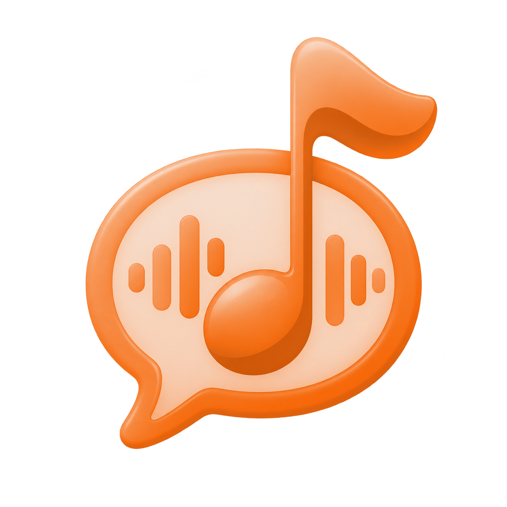
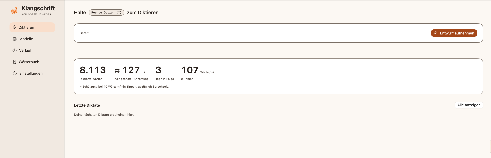
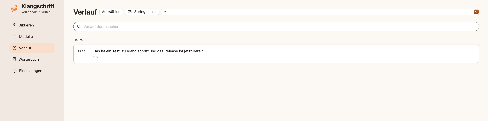
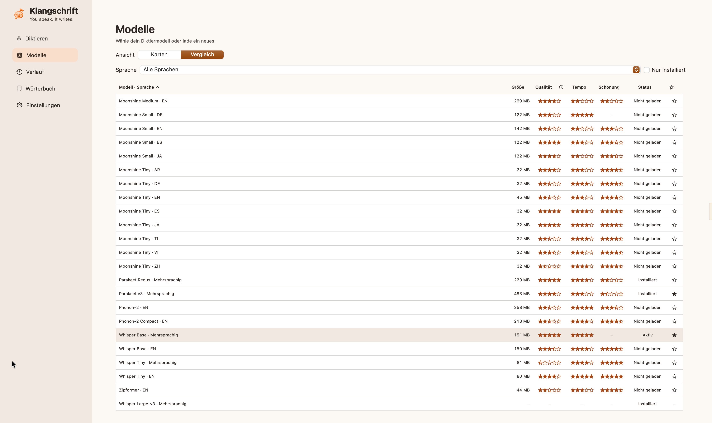
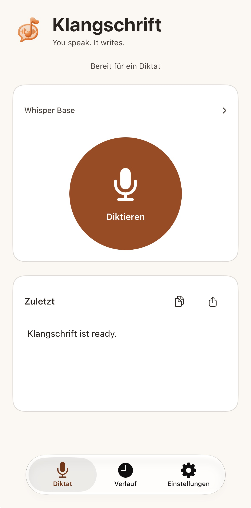
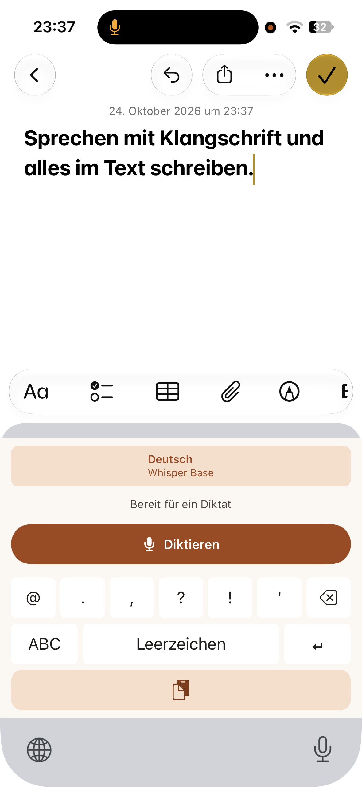
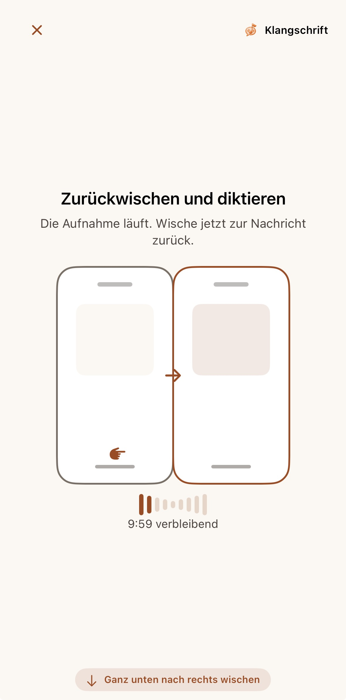
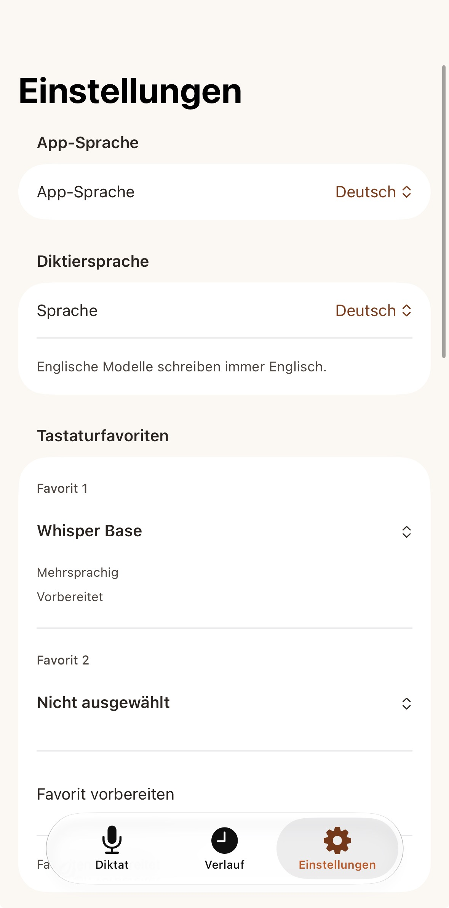

# Klangschrift

[Deutsch](README.de.md)

Dictation on Mac and iPhone. Speech recognition runs on the device, and your recordings stay on your device.

## What it does

- **Mac:** Hold a key, speak, release – the text appears in the active window. A small pill at the edge of the screen shows that Klangschrift is listening. There is also a searchable history with a calendar.
- **iPhone:** a custom dictation keyboard for every app, plus history and storage management.
- **Dictionary:** custom words and replacements, so names and technical terms are spelled correctly.

More pictures

  
  
  
  

## Install

**Mac** (Apple Silicon, macOS 26 or newer):

1. Download the ZIP from [Releases](https://github.com/miggidev618/klangschrift/releases), unzip it and move `Klangschrift.app` to the Applications folder.
2. **First launch:** Klangschrift has no Apple signature, so macOS blocks it at first. Open System Settings → Privacy & Security, scroll down and click **“Open Anyway”** next to Klangschrift. Then open the app again and confirm.
3. **Allow access:** The setup asks for Microphone, Accessibility and Input Monitoring. **After allowing Input Monitoring, quit Klangschrift once and open it again** – macOS only applies this permission after a restart.
4. **First start takes a few minutes:** Klangschrift downloads the speech model (Whisper Large v3, about 3 GB) and checks it. This happens only once.

**iPhone:** Build the app yourself with Xcode; see [Build for iPhone](docs/BUILD-IOS.md).

To build the Mac part yourself: [Build for Mac](docs/BUILD-MAC.md).

## More

- [Privacy](docs/PRIVACY.md)
- [Models](docs/MODELS.md)
- [Changes](CHANGELOG.md)

## License

GPL-3.0 – see [LICENSE](LICENSE). Third-party components retain their own licenses; see [THIRD-PARTY-NOTICES.md](THIRD-PARTY-NOTICES.md).

© 2026 miggidev618
