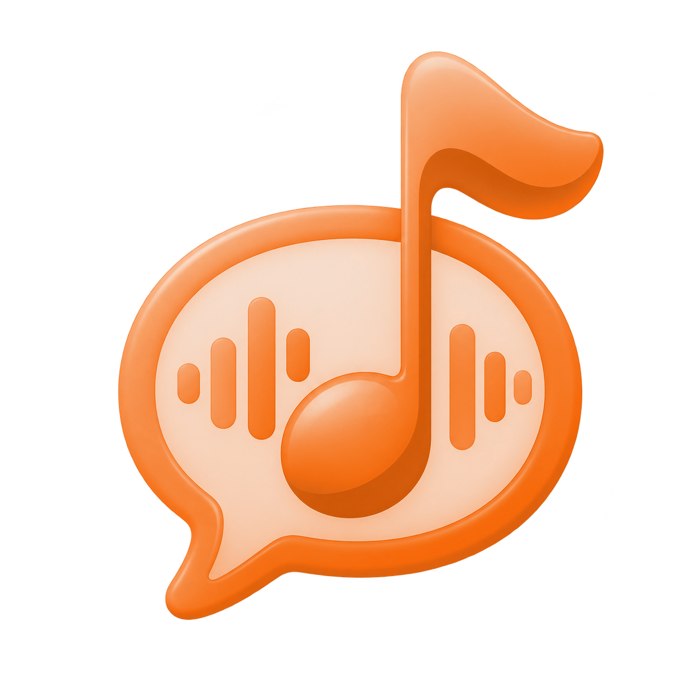

# Klangschrift

Lokales Diktieren für Mac und iPhone. Klangschrift verarbeitet Aufnahmen auf dem Gerät; Modelle und Paketabhängigkeiten werden bei Einrichtung aus ihren jeweiligen Quellen geladen.

| Plattform | Version | Bereitstellung |
| --- | --- | --- |
| Mac | 1.0 (Build 59) | Selbstbau aus diesem Quellcode |
| iPhone | 1.0.1 (Build 29) | Selbstbau in Xcode auf dem eigenen Gerät |

## Funktionen

- **Mac:** Sprechtaste und verschiebbare Pille, Verlauf mit Kalender, Bearbeiten und Kopieren sowie eigene Wörter und Ersetzungen.
- **iPhone:** kompakte Diktattastatur, Rückkehr zur vorherigen App, Wischhinweis an der unteren Gestenzone sowie Verlauf und eigene Schreibweisen.
- **Lokal:** Diktate bleiben auf dem Gerät. Die Wirkung eigener Wörter hängt vom gewählten Modell ab und ist nicht garantiert.

## Bauen

Klangschrift wird derzeit aus dem Quellcode gebaut. Eine allgemein installierbare iPhone-Datei und ein beglaubigtes Mac-Paket werden nicht angeboten.

- [Mac bauen](docs/BUILD-MAC.md)
- [iPhone bauen](docs/BUILD-IOS.md)
- [Datenschutz](docs/PRIVACY.md)
- [Modelle und Quellen](docs/MODELS.md)
- [Drittanbieterhinweise](THIRD-PARTY-NOTICES.md)

Für den Mac wird Apple Silicon vorausgesetzt. Das aktuelle offizielle Moonshine-SDK wurde für macOS 26 gebaut; frühere macOS-Versionen sind damit nicht geprüft. Für das iPhone benötigt man einen Mac mit Xcode, ein zum gewählten Modell passendes iPhone und eine eigene Apple-ID für das persönliche Entwicklungsteam.

## Hilfe

Bitte keine Audioaufnahmen, Diktate, privaten Verläufe, Tokens oder Gerätekennungen in Fehlerberichte aufnehmen. Beschreibe stattdessen Gerät, Systemversion, gewähltes Modell und reproduzierbare Schritte.

## Lizenz

Copyright (c) 2026 miggidev618.

Der eigene Code steht unter [GPL-3.0-only](LICENSE). Drittbestandteile behalten ihre jeweiligen Lizenzen; siehe [THIRD-PARTY-NOTICES.md](THIRD-PARTY-NOTICES.md).
