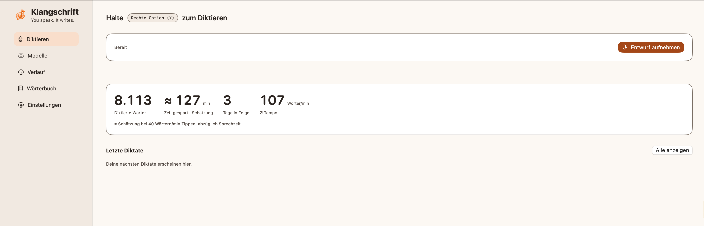
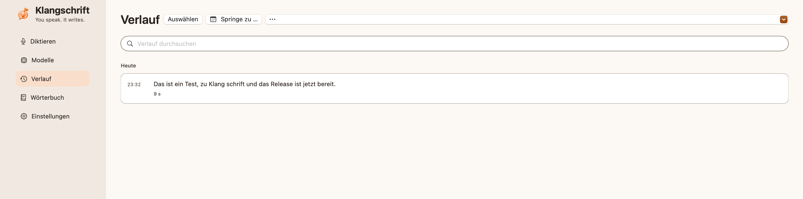
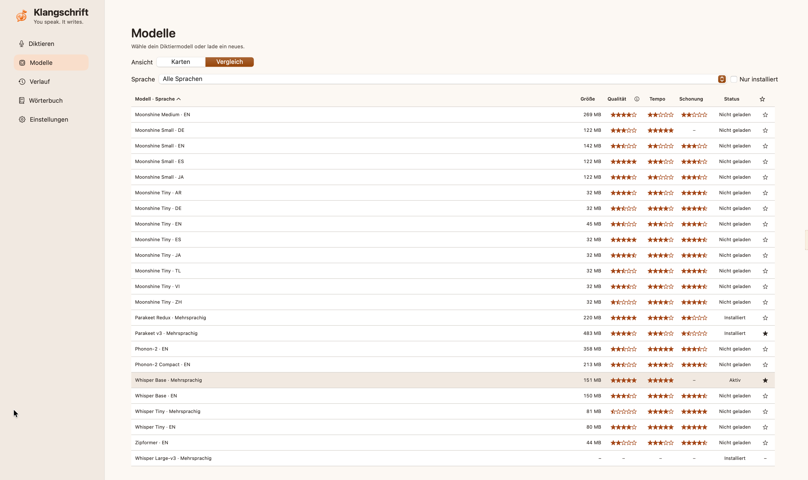
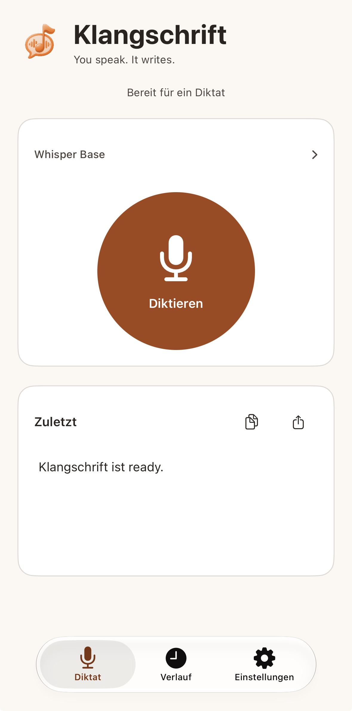
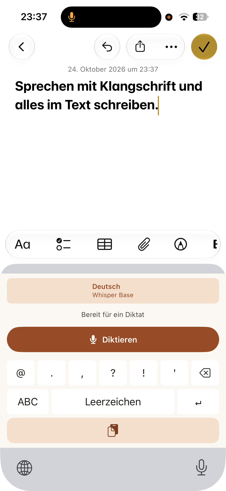
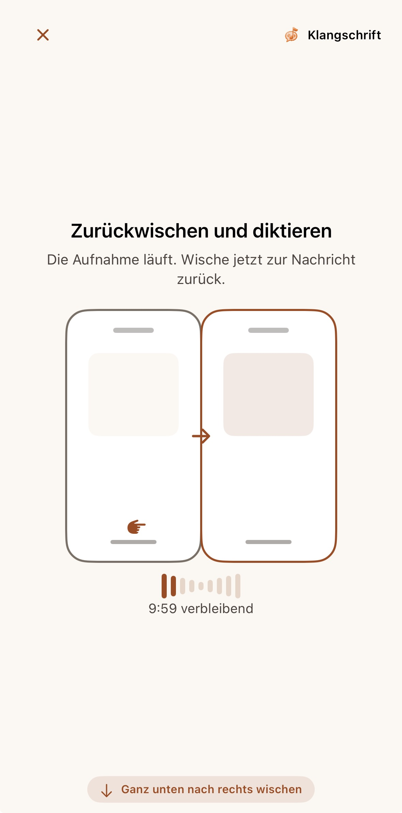
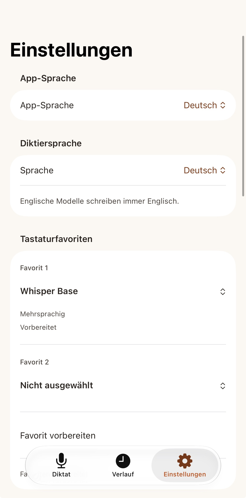

# Klangschrift

Diktieren auf dem Mac und dem iPhone. Die Spracherkennung läuft auf dem Gerät, deine Aufnahmen gehen nirgendwo hin.

## Was es kann

- **Mac:** Taste halten, sprechen, loslassen – der Text landet im aktiven Fenster. Eine kleine Pille am Bildschirmrand zeigt, dass Klangschrift zuhört. Dazu ein Verlauf mit Suche und Kalender.
- **iPhone:** eine eigene Tastatur zum Diktieren in jeder App, dazu Verlauf und Speicherverwaltung.
- **Wörterbuch:** eigene Wörter und Ersetzungen, damit Namen und Fachbegriffe richtig geschrieben werden.

Mehr Bilder

  
  
  
  

## Installieren

**Mac** (Apple Silicon, macOS 26 oder neuer): Die App unter [Releases](https://github.com/miggidev618/klangschrift/releases) herunterladen, entpacken und in den Programme-Ordner ziehen. Beim ersten Start meldet macOS, dass die App von einem nicht verifizierten Entwickler stammt. Dann mit Rechtsklick → Öffnen starten oder unter Systemeinstellungen → Datenschutz & Sicherheit → „Dennoch öffnen“ erlauben.

**iPhone:** Die App selbst mit Xcode bauen, siehe [iPhone bauen](docs/BUILD-IOS.md).

Wer den Mac-Teil selbst bauen will: [Mac bauen](docs/BUILD-MAC.md).

## Mehr

- [Datenschutz](docs/PRIVACY.md)
- [Modelle](docs/MODELS.md)
- [Änderungen](CHANGELOG.md)

## Lizenz

GPL-3.0 – siehe [LICENSE](LICENSE). Fremde Bestandteile behalten ihre eigenen Lizenzen, siehe [THIRD-PARTY-NOTICES.md](THIRD-PARTY-NOTICES.md).

© 2026 miggidev618
